[Studying in my 60s](https://github.com/Hermann-SW/Hermann-SW.github.io/tree/master/studying_in_my_60s#studying-in-my-60s) at Heidelberg/Germany University:

- [future lectures](https://stamm-wilbrandt.de/GraphvizFiddle/#_math) currently planned to attend
- [fall 2026](#fall-2026)
- [spring 2026](#spring-2026)
- [fall 2025](#fall-2025)

# fall 2026
(4 lectures, 1 seminar)  
- [Algebra 1](#algebra-1)
- [Introduction to Optimization](#introduction-to-optimization)
- [(S) Fermat and Number theory](#s-fermat-and-number-theory)
- [Elementary Hyperbolic Geometry](#elementary-hyperbolic-geometry)
- [Higher Analysis](#higher-analysis)
- [Interactive theorem proving in Lean](#interactive-theorem-proving-in-lean)

## Algebra 1

Script and exercises behind VPN on mampf.mathi.uni-heidelberg.de

[Weeks 1-4 of script as English and German language Graphviz graphs](https://github.com/Hermann-SW/graphviz_latex_pipeline/tree/main#algebra-1-weeks-1-4)  
145 searchable LaTeX nodes (definitions, theorems, $\dots$ / Definitionen, Theoreme, $\dots$):  
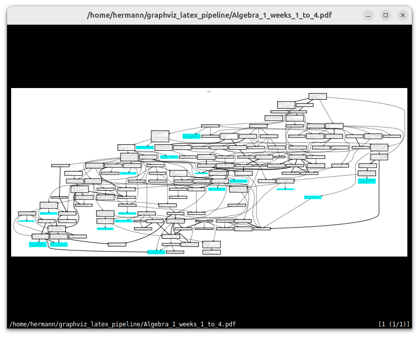

## Introduction to Optimization

Script, recordings and exercises:  
https://scoop.iwr.uni-heidelberg.de/teaching/2026ws/lecture-grundlagen-der-optimierung/

## (S) Fermat and Number theory

Seminar on book "[KKS00] Kato, Kazuya, Nobushige Kurokawa, and Takeshi Saitō. Number Theory: Fermat’s dream. AMS Bookstore, 2000."

Functions f,g,h in Lemma 1.5 of [proof tree](https://raw.githubusercontent.com/Hermann-SW/uni-heidelberg/main/res/Fermat_seminar.pdf) [built with [graphviz_latex_pipeline](https://github.com/Hermann-SW/graphviz_latex_pipeline) repo]  
of "Elliptic curves and Fermat's proof" (for $n=4$, click for 100% size PDF):  
<a href="res/Fermat_seminar.pdf">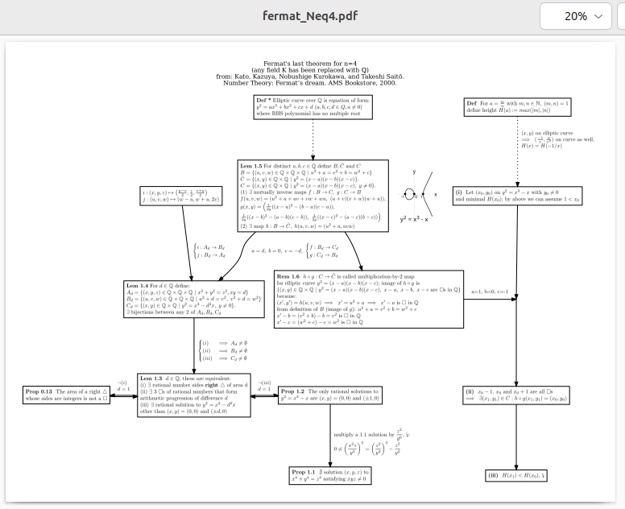</a>

§1.2 formula 1.4, this is called map2P in symbolic proof below:  
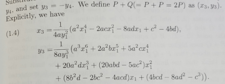

Symbolic proof of equation equalities using WolframScript [1_5.wls](scripts/1_5.wls):  
[there is [free for personal and educational use license](https://www.wolfram.com/engine/free-license/) of wolframscript]   
```
hermann@8840hs:~/uni-heidelberg$ wolframscript -f scripts/1_5.wls
=== 1. Proof that f(u, v, w) maps into C ===
True

=== 2. Proof that g(x, y) maps into B ===
True

=== 3. Proof that h(u, v, w) maps into C~ ===
True

=== 4. Testing f(g(x, y)) ===
{x, y}

=== 5. Testing g(f(u, v, w)) ===
{u, v, w}

=== 6. Proof that (h o g)(x, y) == map2P(x, y) ===
True

=== 7. (x0,y0) on y^2=x^3-x => ((x0+1)/(x0-1),2y0/(x0-1)^2) on y^2=x^3-x ===
True

hermann@8840hs:~/uni-heidelberg$ 
```

Just in case it might be interesting, discussion with Gemini on Lenstra's Elliptic Curve Method for factoring resulted in 156 lines GMP C++ code that works (slowly), with Gemini analysis on why that is much slower than Linux ```gmp-ecm``` package, in this [gist with comments](https://gist.github.com/Hermann-SW/57a3a898c498e96fdf8589b87a0dab8a). 

<a name="Observation">Observation not part of book chapters I have read:

Given two points $(x_1,y_1)$ and $(x_2,y_2)$ with $x_1\neq x_2$ there is a unique elliptic curve going through both points. Can be simply seen by rewriting eliptic curve formula $y^2=x^3+ax+b$ as $y^2-x^3=ax+b$. For a given pair $(x,y)$ the left hand side is constant, and two points result in simple system of two linear equations and two variables $a$ and $b$. Script [unique_ec.py](scripts/unique_ec.py) (generated with 3 prompts in 10 minutes by free gemini.google.com) allows to easily display that curve via matplotlib, example:  
```python scripts/unique_ec.py 9 2 7 6```

Animation shows curves through 2 integer points with $x^2+y^2=85$ (e.g. $(9,2)$ or $(7,6)$⁠), differing by sign and order only. Here is [100% size animation](res/ecs_85_anim.gif):  
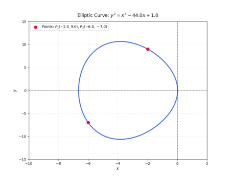  
  
[unique_ec_ℚ.py](scripts/unique_ec_ℚ.py) allows for rational coordinates, aspect preserving zoom in/out and dynamic redraw. Alternative input now allows to specify rational a and b for elliptic curve $y^2=x^3+ax+b$ or a, b and c for elliptic curve $y^2=x^3+ax^2+bx+c$ as well:     
```
$ python unique_ec_ℚ.py 
Usage options:
  1) python unique_ec_ℚ.py x1 y1 x2 y2       (Specify via two rational points for y^2 = x^3 + bx + c)
  2) python unique_ec_ℚ.py x1 y1 x2 y2 x3 y3 (Specify via three rational points for y^2 = x^3 + ax^2 + bx + c)
  3) python unique_ec_ℚ.py b c               (Specify via curve parameters b and c for y^2 = x^3 + bx + c)
  4) python unique_ec_ℚ.py a b c             (Specify via curve parameters a, b, and c for y^2 = x^3 + ax^2 + bx + c)
Example 1: python unique_ec_ℚ.py 9/2 1 7/6 1
Example 2: python unique_ec_ℚ.py -1 0 1 1 2 2
Example 3: python unique_ec_ℚ.py 0 -4
$
```

Additionally the discriminant of the polynom is determined and aborts in case of 0, which means a multiple root and therefore not being an elliptic curve:
```
$ python unique_ec_ℚ.py 0 0
Using curve parameters: a(x^2)=0, b(x)=0, c=0
Discriminant Δ = 0
Error: Singular curve! The cubic x^3 + ax^2 + bx + c has multiple zeros (Δ = 0), so it does not define an elliptic curve.
$ python unique_ec_ℚ.py 1 0 0
Using curve parameters: a(x^2)=1, b(x)=0, c=0
Discriminant Δ = 0
Error: Singular curve! The cubic x^3 + ax^2 + bx + c has multiple zeros (Δ = 0), so it does not define an elliptic curve.
$ 
```

In case cypari2 module is installed, "Find ellratpoints" checkbox allows to determine and display all rational points on elliptic curve up to height specified in "Height" input field (via cypari2 PARI/GP function ```ellratpoints()```). Button "Zoom to all points" resets zoom so that all points up to height are visible. Rational point coordinates hover help gives details.  
<table><tr><td><a href="res/unique_ec_ellratpoints.png">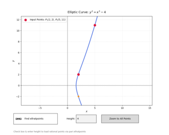</a></td><td>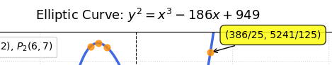</td></tr></table>


## Elementary Hyperbolic Geometry

Script and exercises behind VPN on mampf.mathi.uni-heidelberg.de

Interactive [Hyperbolic Triangle Explorer](https://stamm-wilbrandt.de/hyperbolic_triangle_explorer/) runs via pyodide in browser. For running locally use [t7.py](scripts/t7.py):  
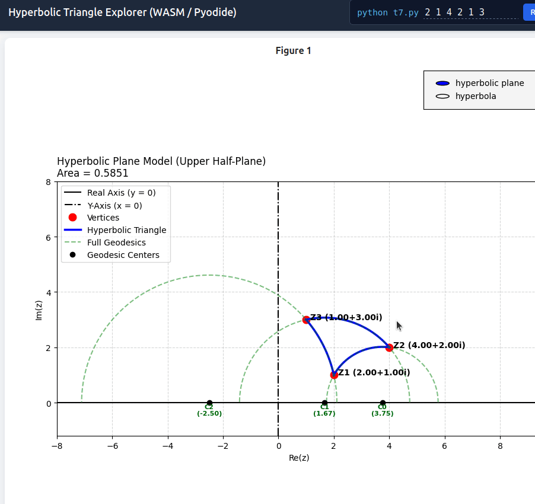

Form lecture 12:  
**Theorem 5.11.** The Möbius transformations $\text{Möb}(\overline{\mathbb{C}})$ act 3-point transitively on $\overline{\mathbb{C}}$.
That is, for two ordered triples $(z_1, z_2, z_3)$ and $(w_1, w_2, w_3)$ of pairwise distinct points in $\overline{\mathbb{C}}$, there exists a unique Möbius transformation $\mu \in \text{Möb}(\overline{\mathbb{C}})$ with $\mu(z_i) = w_i$ for $i \in \lbrace 1, 2, 3\rbrace$.

I asked gemini to create script [mobius_3point_trans.py](scripts/mobius_3point_trans.py) on that, for playing with:  
```
hermann@8840hs:~/uni-heidelberg/scripts$ python mobius_3point_trans.py 8+1i 1+8i -1+8i 1+8i -1+8i 8+1i 4+7i 0.2281660893852303+6.5169939280656415i
a = (0.5+4.142857142857143j)
b = (32.642857142857146-1.1428571428571428j)
c = (0.5021978021978022+0.017582417582417582j)
d = (0.5-4.142857142857143j)

Fixpoint 1: (0.34876894325387453+9.961712941688791j)
Fixpoint 2: (0.2281660893852303+6.5169939280656415j)

(4+7j) -> (0.4858891533491999+8.047602856171371j)
(0.2281660893852303+6.5169939280656415j) -> (0.22816608938522856+6.516993928065638j)
hermann@8840hs:~/uni-heidelberg/scripts$ 
```

## Higher Analysis

Script and exercises behind VPN on mampf.mathi.uni-heidelberg.de

https://github.com/Hermann-SW/graphviz_latex_pipeline#banach-tarski-paradox

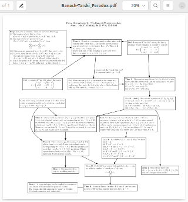

## Interactive theorem proving in Lean

Course material available on github:  
https://matematiflo.github.io/LeanCompactCourse2026/

[Lean proof](https://live.lean-lang.org/#codez=JYWwDg9gTgLgBAWQIYwBYBtgCMB0BBAOyXQE8BnYMnAZTAFMBjYAM2AYBlRgYqAhJCgwBQoSLEQoM2HABEUSHADkUOAMKoIEMnRz9BI8NHjI0mXABUIkdBADmJfOlt0sUBQEkCrAtzrUAriA4AEp0xAZixpJmOOZIDDBsQkJWdARwAGLABNrwWegwdFBwltZ2JMkA9AC0AIRCAMRNcHj%2BAB7AmEhQJHC82RAgwMRw7gAmaYmJdGRwSARjfRD%2BC2RC1ZVV1dVwquhhUHRj1cxuCcAQ6czQIHAQzHBodHAACgIMxNUwJPSPdPtkBhWbK2ODACYEKa9bJwAAGgFRCWEAGiESAAbhBwSC4EQYP43OgcYEsEU4GR%2FFgYGdEpc4AAKWE8CmwgCUODgGyE%2BxAICQcAYGi0dAA%2BoUAUD6MLcfT0gArOAALjg8JZiqEcA19PlAGo4ABGVUAKhlcF1BpwAs02i1pv1RpxFsF1rpOrtpvVmo1LttACZ7XT0ma2ZahTbdX64MaCI6rc9vUG4ABeD1e10R40B23mkPOtP%2BwN2mOh%2BNuhWJuBYCoaj7oYSeksGyMmoNF3NZ%2B3RnNx12N7Upz1huDp5uFruD4edp3d9v9jXlzMtscN%2F09jut6cJvsDzUL0dT8cr31rperxXlytwKAg%2FvCpMjxtR9dweWPk%2Ft93br0Fh8Ot8J1%2F7suZ4VlWA5QAA7nAADagAJhHAygwDgSBjGMwqXCKID%2BOgwpdsKdAAI44s%2BSJwHBCFIShaEEBhWE4VOeGEeky4ALo3neu4%2FpOsaDj%2BAZPq6XHFquqpliBl7Xp6t7zt%2BwaAXmTYlsOHGydxQGiZWs6XpBUHkchqHocKmHYbhBFEcuJFkSouHkgwDDCjZDBEbKrGSex8kZjJT6Kfm7Zeae6m9FeBC2FsOyhEwYBQBANYVgMQwjGKMwStiZCFGAcDXMUTxggQ1HFOStwQGipKwoAuISwuynLcryOVonRsYMfZFL0sAz6KsqIn9nS3WtbqroACwqUJR7taVLKAN4EACdqrJtu3XykqY0jZU9Leotqr%2FqtdK9W1uoAMxDW2CbrVNqrVJp82jRtQ6qitl3re%2BGY9Vmtqugdfnvid03ARpGq5ERok7W9HqoOizyoOkSpA7a%2FV3t%2BwFQMw6Ag2DcAQwA5O1O16q9tp7XDL0BXcIB0LYSAehB0EQyRGMuWjqOoLKONKmtcBLWacCAAZEcAAAw%2Fb0kAUIkaLcKBoPFWjDDMzKH3HWzqrc3zZb9uRHypVKIoAF5FBAODgMUdKq%2FRgv0hegyk0gLJstR6MoxLqAMD67XdZ5f6lvLXO82eKtWQIMAa8K2tRXrkX0kbDUm3SZsk2TVs4Dbdvgww%2BMs8pss3VdntK7Nmqq37AdB7r%2Bth1ZxtaKbvTm7H1t0LbGri%2BDwrgmqc2s%2BzbpPa7cmfR7Hnp42D1bp%2B90e%2BG%2Fpp27EYPX3bsDx7Of1m311KRP3dj5nne%2BbPIkewF%2FZ0G08T%2ByAECoWr8C4YlgKpFKKBOR6rD%2FKhFDgB6mBEFeaChXAACiaLEP4FAMw4RO2NKoEse0SKnnnG9Fk3lYRwHAtwDQ%2Fh4BjGACLCgtJoBwiZFgCqHJNjVT5LhPSopUCHBothGA4EIA2iVCqFuO5YH93tE7GBeNDzrz3hqSmUEAAC4chT2RIDyYUekeKqh9BZeCKgyEGSMvVYRplvL6hIkI7QVERRXlsKgGArEhA1B2Jwai3Q4A2HAqSLAywFhwkUHAQAJkS7ENrjfaUD2wIP8NoRYMA6FkA0JBbKV9krBUeEgTocB%2F4%2BH8TMSqRC6A8j5PsJRmiyFoEoTaexDCd72KcS4vqnDWH8w9NkMY%2Fhzi0nsUgr%2BGoAA%2BcBC5JgAHxwAPkfWRiFC7Cn2HAYUHp6kOXgmCVAzT%2BwNzRibJUOM8n2IKftQ6zwFrlg0SKSO0cLYsjGQzMAAhnazP1K4uA71t5Jk0l6fZLCxyunybtI5CzJHFO3Hw%2FxEBIL7JxnMo5d4Ll4xeussmdNPRtISB09cTVbLgscjc2Bz5%2BxV3JoYuojRmh6nZJ4PKcAAi3HYAk3k6xNiIp2LCAAEgILFCDMqFQeNlbIGKCr0kymSVALBCiLFKQfOEaZWRxK5LivkoMyBYqbrlUkrNGEKn7KSwVgQGUrDBO1eEzStrQ11INdOU95anU2XNJ2d0R7t14kvThVtHlaSpmSwITdmDMFFGkMYqUIC339vcKUlxqKgjpMwOVrVEwtIvILbgGDRYsjpvseAoIGFwEAEmEbNgJevSD6ppXUjXrz1QtUeHdlWHOOWvd2Y1TqJzRranpSpAAAREMhhKI5qAEQieVgAIIkvPMZw8ESLdW2octVk8d75umjNOAoI%2BY7FBFk8s8ahm%2BpAv2GsULa2tQbW4YKzxFCtuep8ztuaNU9qtppKScBZ1wHnU2pdrbQStSHS1dsIkF4DgKjhS4thiiI0JGO1qUkWnZDqiZfCTUsDytlDuu8A6OT9oreWW9C7nA%2FsxsOwtqBbBKxA3zcsuqtrpoNePND10DpXsnZ6e1ohoK2EBWanSKgul6WI%2BM1AdFnYQPuWpeeq1MOcIUimjOK0nY8IHO%2FboyDoIvMgpdeZRTp5DnYmxg6rHmPr1%2Bp%2BYFx9T44T9vyeiaSKF0CoaKWhz5iN8OowKYjj90DP1ELB4VdVGlKnMHah1sr0hZOVEqttPzhMnK%2BialApR6SAFYNwAuzu8yvf2QoqxfHmfETAUogcdYWkGOlAAPLUzSwX7Whc81YQylw6GerlfYidF55MZbPsp5JpDKLpI021RQ2rPzJYdU61Q%2Bc0tgHC6UWDtgHPWZC3Q0ETWfP%2BZ5jh2Tf1RB8igoowuzE4BeOxNRj9UXg5AhyMfLCqHM6pqY2tu01WX47KpvBki5IsDzYgJN6boS6S1dC4t9WBBUD2pwIdtG7Xgz3oNmO3LLS6TUcSvBNkZBREgE2YSyMhp0WkixXAHFiTDSGiVHsIUixKV3AeLCatmNgAkXASquA%2FV3FjymgQqqfKcp5SaiAFJ05slMK9Gj%2BVlas1rvo%2FJdzM1NIobbdJzN%2BqsMmuVl6AVQraWkllGyJk5OCJbHqE0BoQ52QAHlUHg5leYVAdBoAJPxd%2FElFqQAUpuMjx4qu7iK%2FyoEEii3iqwGxNlH01RUp0HSsE1IcI9SVBdNqRsOxXfu4OrCEQkI6F8j1HbtKfxxTO5JW1HYxLJEIOqSMyP8pyze9lB766KftR%2BkJ%2FExJ9NpXk%2BWIUYoErPRSoh9luUCqlXs%2B549Dbg87kmrpPjDjg3QJ6Z11am1l3HW4jQjaggbrSZ2banlgWWhA0i2%2BCGt%2BdB4Ax8jTG0qca5VJ8%2B7XoMp1bQc8236At9cGb2VD2Wtq9Oa9scNZz7Dd4Y%2Fymjw80SY61%2B4c1Ph8A0FiXEbAF4%2FTft%2BxGZM1fk9CChCgP3tmLWeBPwc3hCrQHDpFrXlEPUXRbXpHP050v022wxNXLBj0HTgBjxHQyhyyVSG35GIBnTaiQObWXVQLgD1Qvww0wKtm3W3F3QQIPUbWQJoLpFv2Axj2XBw1vUWwfUvCRiIMrzfSLXt3Sn%2FVYJvy9nv0IPAyPSg3wPglg2JQQ1wLvBbzEy4w1Df3Sigk%2F37EHygHJwIECFg2lk6xSyy3eyrwnWc02wNC1TmAiysD6wC29k9B7zCya2Oxi3fwSySxs1Sw8OaxPkHxHw%2BzEh40%2FlQFVD8NxAa3VgCKa1g04xKDCPsOIMjScO6gc3bj317XcK8zpD828L501D8LmwCMLiCPi0S23D8ICKiNyPsxIN6HiOQSSJyPq0awiJaysA0I6xyLUN6wqP6zb37B2z5DO1BFQFRQkVQB9A9DmKpk0IOwpGO1OwoHOz8Ou39lu3u0e1QGJSqxi2Cje2IKcO%2B3%2BCXT%2BwByByMRBwVyL0xWV1V3VxABhysyNzGGWCwB6W0CvGAXuEvEYGAEimihGCwDimGEJCBDoGtTYGAEmFmAIkAXQFmFhF0J9GzyECeB%2BONyLzJ2p3pFp3TRgL3XRwVRXXbUZ3VW7QmlKPLHxNNR22FD4SFygDJwpzpnkzzyFULyKBwDFwYmSAaEimyHgCQA6EGFmFFL5IKiAA)  generated by gemini for a theorem on reciprocal binomial coefficients I discovered and proved more than 40 years ago in school:  
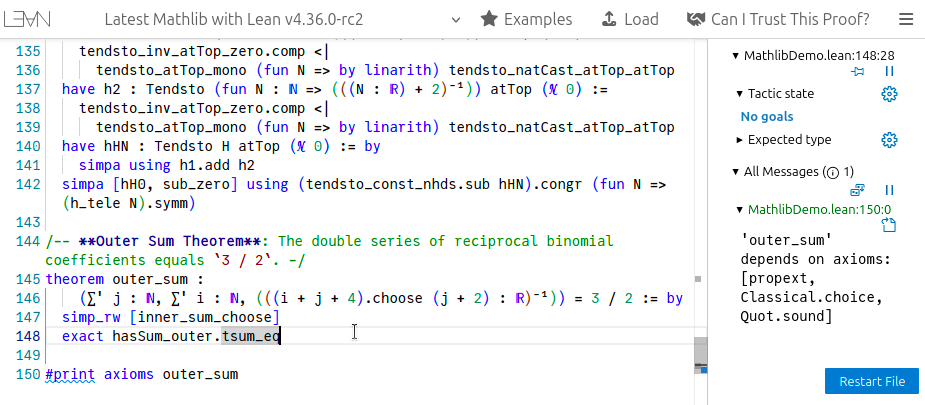  

There are 8,719 ```*.lean``` files in [mathlib4](https://github.com/leanprover-community/mathlib4)'s Mathlib directory. Starting from ```Mathlib/NumberTheory/SumTwoSquares.lean``` there are 1,599 files 21 levels deep directly (and mostly indirectly) imported for [sum of two squares theorem](https://en.wikipedia.org/wiki/Sum_of_two_squares_theorem) proof (only 235 lines [SumTwoSquares.lean](https://github.com/leanprover-community/mathlib4/blob/master/Mathlib/NumberTheory/SumTwoSquares.lean)):  
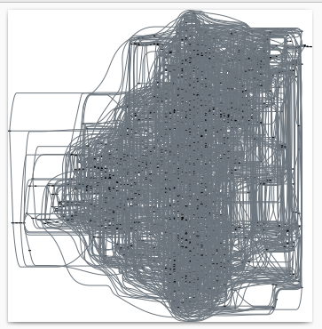

Diagram above created with [ImportsToDot.py](scripts/ImportsToDot.py). More readable example ([GraphvizFiddle link](https://stamm-wilbrandt.de/GraphvizFiddle/?1794873871562#digraph%20LeanImports%20%7B%0A%20%20rankdir%3DLR%3B%0A%20%20ranksep%3D1.2%3B%0A%20%20nodesep%3D0.3%3B%0A%20%20node%20%5B%0A%20%20%20%20shape%3Dbox%2C%0A%20%20%20%20style%3D%22rounded%2Cfilled%22%2C%0A%20%20%20%20fillcolor%3D%22%23f8f9fa%22%2C%0A%20%20%20%20fontname%3D%22Helvetica%2CArial%2Csans-serif%22%2C%0A%20%20%20%20fontsize%3D8%2C%0A%20%20%20%20margin%3D%220.05%2C0.05%22%2C%0A%20%20%20%20height%3D0.3%0A%20%20%5D%3B%0A%20%20edge%20%5Bcolor%3D%22%236c757d%22%2C%20arrowsize%3D0.7%5D%3B%0A%0A%20%20%22Mathlib.Data.Set.Defs%22%20-%3E%20%22Batteries.Util.ExtendedBinder%22%3B%0A%20%20%22Mathlib.Data.Set.Defs%22%20-%3E%20%22Mathlib.Tactic.SetNotationForOrder%22%3B%0A%20%20%22Mathlib.Data.Set.Defs%22%20-%3E%20%22Mathlib.Tactic.ToDual%22%3B%0A%20%20%22Mathlib.Logic.Function.Defs%22%20-%3E%20%22Mathlib.Init%22%3B%0A%20%20%22Mathlib.Logic.Function.Defs%22%20-%3E%20%22Mathlib.Tactic.Attr.Register%22%3B%0A%20%20%22Mathlib.Logic.Relation%22%20-%3E%20%22Batteries.Logic%22%3B%0A%20%20%22Mathlib.Logic.Relation%22%20-%3E%20%22Mathlib.Logic.Relator%22%3B%0A%20%20%22Mathlib.Logic.Relation%22%20-%3E%20%22Mathlib.Order.Defs.Prop%22%3B%0A%20%20%22Mathlib.Logic.Relation%22%20-%3E%20%22Mathlib.Order.Defs.Unbundled%22%3B%0A%20%20%22Mathlib.Logic.Relation%22%20-%3E%20%22Mathlib.Tactic.MkIffOfInductiveProp%22%3B%0A%20%20%22Mathlib.Logic.Relation%22%20-%3E%20%22Mathlib.Tactic.SimpRw%22%3B%0A%20%20%22Mathlib.Logic.Relation%22%20-%3E%20%22Mathlib.Tactic.Use%22%3B%0A%20%20%22Mathlib.Logic.Relator%22%20-%3E%20%22Mathlib.Logic.Function.Defs%22%3B%0A%20%20%22Mathlib.Order.Defs.Prop%22%20-%3E%20%22Mathlib.Tactic.ToDual%22%3B%0A%20%20%22Mathlib.Order.Defs.Unbundled%22%20-%3E%20%22Mathlib.Data.Set.Defs%22%3B%0A%20%20%22Mathlib.Order.Defs.Unbundled%22%20-%3E%20%22Mathlib.Tactic.ExtendDoc%22%3B%0A%20%20%22Mathlib.Tactic.SimpRw%22%20-%3E%20%22Mathlib.Init%22%3B%0A%20%20%22Mathlib.Tactic.ToDual%22%20-%3E%20%22Init.Core%22%3B%0A%20%20%22Mathlib.Tactic.ToDual%22%20-%3E%20%22Mathlib.Tactic.Translate.ToDual%22%3B%0A%20%20%22Mathlib.Tactic.Translate.ToDual%22%20-%3E%20%22Mathlib.Tactic.Translate.TagUnfoldBoundary%22%3B%0A%7D%0A)):  
```python ImportsToDot.py Mathlib/Logic/Relation.lean --max-depth 5 > 5.dot```
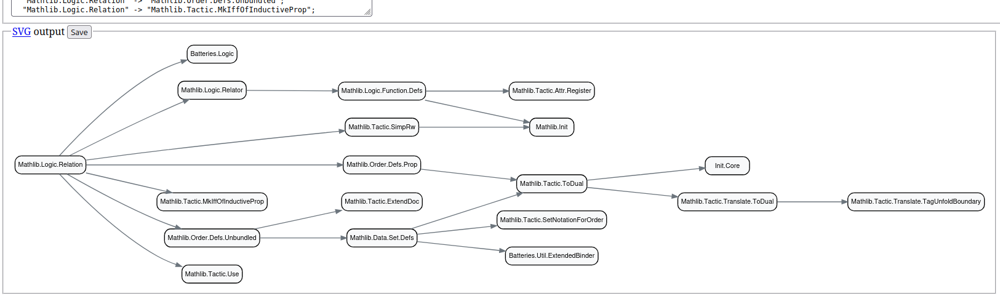


# spring 2026
(5 lectures)
- [Linear Algebra 2](#linears-algebra-2)
- [Analysis 2](#analysis-2)
- [Hardware-Aware Scientific Computing](#hardware-aware-scientific-computing)
- [Elementary number theory](#elementary-number-theory)
- [Berkeley math 115: Introduction to number theory](#berkeley-math-115-introduction-to-number-theory)

## Linear Algebra 2

Script, recordings and exercises:  
https://scoop.iwr.uni-heidelberg.de/teaching/2026ss/lecture-lineare-algebra/

[strassen.4x4.py](scripts/strassen.4x4.py) uses 6-dimensional Strassen tensor of rank 49 for 4x4 matrix-matrix multiplication (standard tensor has rank 64, AlphaTensor tensor rank 47, the proven lower bound): [markdown/strassen.md](markdown/strassen.md)

## Analysis 2

Script and exercises behind VPN on mampf.mathi.uni-heidelberg.de

## Hardware-Aware Scientific Computing

Script behind VPN on moodle.uni-heidelberg.de, but repo accessible:  
https://parcomp-git.iwr.uni-heidelberg.de/Teaching/hasc-code

benchmarking: find nice [pointer_chasing.cc](https://parcomp-git.iwr.uni-heidelberg.de/Teaching/hasc-code/-/blob/master/benchmarking/pointer_chasing.cc?ref_type=heads) diagrams for 6 different CPUs with between 4 and 24 cores [here](markdown/pointer_chasing.md) 

[STREAM](https://parcomp-git.iwr.uni-heidelberg.de/Teaching/hasc-code/-/tree/master/stream?ref_type=heads) is the de facto industry standard benchmark for measuring sustained memory bandwidth. Find output, discussion, … when executed on 8× 24C/48T Intel Xeon E7 8890v4 CPUs in Lenovo x3950-X6 8-socket server [here](markdown/stream.md) (… true memory bandwidth for Scale and Triad was 549 GByte/s and 561 GByte/s …)

[Sheet 2 Exercise 2](markdown/sheet_2_exercise_2.md): avx512 fma code shows peak 1261 GFLOPS on 16C/32T AMD 7950X CPU

[cpufp measurements](markdown/cpufp.md) for my 8/16/2×22/8×24 core systems

[Sheet 5 Exercise 1bc](markdown/sheet_5_exercise_1bc.md): implement tree-barrier and provide code to test correctness and do performance tests comparing to existing barrier implementations

Acoustice wave equation [exam project](markdown/Acoustic_wave_equation.md) with details and later parallelization on GPUs.

## Elementary number theory

Fall 2024 script, recordings and exercises behind VPN on mampf.mathi.uni-heidelberg.de

[Sheet 8 Exercise 1b](markdown/sheet_8_exercise_1b.md): Show that system of linear diophantine equations is solvable (solution using PARI/GP)

Def 5.26 of script introduces [Carmichael number](https://en.wikipedia.org/wiki/Carmichael_number)s.  
Find efficient to use with PARI/GP ```carm10e24.bin``` containing all 308,279,939 Carmichael numbers <10²⁴ here:  
https://stamm-wilbrandt.de/en/#Carmichael

<a name="contfrac">⁠</a>Continued fraction computations with PARI/GP for example 6.7:
```pari
$ gp -q
? v=contfrac(104629/432000)
[0, 4, 7, 1, 3, 6, 2, 1, 170]
? M = contfracpnqn(v)

[104629  613]

[432000 2531]

? M[1,1] / M[2,1]
104629/432000
? 
```

Exercise 12.2 was on [metallic mean](https://en.wikipedia.org/wiki/Metallic_mean) S(n)=[n,n,n,…]. S(1) is golden, S(2) silber ratio.
We should derive closed formula [S(n)=(n+sqrt(n²+4))/2] and prove that (S(n))³ is a metallic mean again. Related is sequence
https://oeis.org/A352403 "Indices of metallic means that are powers of other metallic means". I submitted new PARI/GP formula, which was approved:
```
(PARI) [i|i<-Set([contfrac(((n+sqrt(n^2+4))/2)^p)[1]|n<-[1..32]; p<-[3..19], p%2]), i<30000] \\ Hermann Stamm-Wilbrandt, Sep 17 2026
```
   
<a name="pell">⁠</a>```fundsol(d)``` in [scripts/pell.gp](scripts/pell.gp) determines fundamental solution of Pell equation x²-dy²=1 per
Cor 6.42 of script.  
```fundpari(d)``` determines it the PARI/GP way based on [quadunit()](https://pari.math.u-bordeaux.fr/pub/pari/manuals/2.17.4/users.pdf#pdf@labse:quadunit):  
```
hermann@8840hs:~/uni-heidelberg/scripts$ gp -q pell.gp
? for(i=2,80,if(!issquare(i),print1(fundsol(i)==fundpari(i))))
111111111111111111111111111111111111111111111111111111111111111111111111
? [x,y]=fundsol(21)
[55, 12]
? x^2-21*y^2==1
1
? 
```
   
In case the norm of quadunit return is -1, u provides fundamental solution for Pell equation x²-dy²=-1:  
```
hermann@8840hs:~/Downloads$ gp -q
? d=29;u=quadunit(4*d);[x,y]=[real(u),imag(u)];norm(u)
-1
? x^2-d*y^2
-1
? 
```

Best option to compute n-th solution to Pell equation is quadunit, here for d=21 from above:
```
? d=21;
? f=quadunit(4*d)
55 + 12*w
? real(f)^2-d*imag(f)^2
1
? u=f^2
6049 + 1320*w
? real(u)^2-d*imag(u)^2
1
? u=f^3
665335 + 145188*w
? real(u)^2-d*imag(u)^2
1
? 
```

For d=29 from above, only odd powers keep solution x²-dy²=-1:
```
? d=29;
? f=quadunit(4*d)
70 + 13*w
? real(f)^2-d*imag(f)^2
-1
? u=f^3
1372210 + 254813*w
? real(f)^2-d*imag(f)^2
-1
? 
```


New repo "graphviz_latex_pipeline" generated PDF with 37 LaTeX node and edge labels:  
https://github.com/Hermann-SW/graphviz_latex_pipeline
<table>
  <tr>
    <td bgcolor="white">
      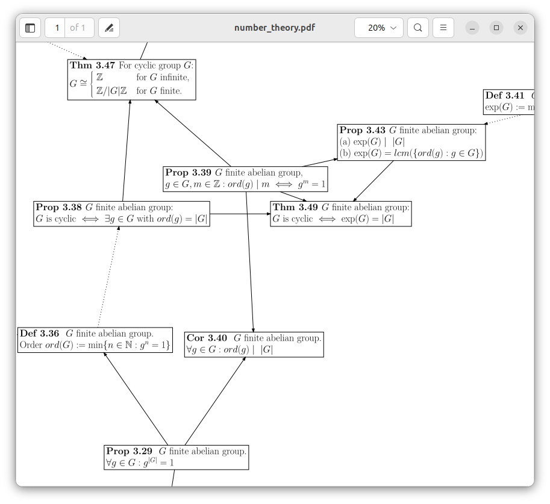
    </td>
  </tr>
</table>

## Berkeley math 115: Introduction to number theory

- Youtube lecture series [spring 2022](https://www.youtube.com/watch?v=EzE6it9kAsI&list=PL8yHsr3EFj53L8sMbzIhhXSAOpuZ1Fov8&index=1)

- My 53 lecture [summaries with example code](markdown/Math155.md)


# fall 2025
(2 lectures, German language only)
- [Lineare Algebra 1](#lineare-algebra-1)
- [Analysis 1](#analysis-1)

## Lineare Algebra 1
- [Algebraische Strukturen Diagramm](https://stamm-wilbrandt.de/GraphvizFiddle/2.1.2/#_LA1): Mengen, Halbgruppen, ..., Körper  
-
- [Automatischer Beweis für Lineare Algebra 1 Hausaufgabe 5.2b](markdown/Lineare_Algebra_1.Aufgabe_5.2b.md)
- [Plenarübung 5 Diskussion, automatisch alle Gruppen mit 6 Elementen](markdown/Lineare_Algebra_1.Plenaruebung_Diskussion.md)
- automatisch [alle Gruppen mit 8 Elementen](markdown/Lineare_Algebra_1.G8.md) bestimmen (sehr rechenintensiv)
- 75 Zeilen Skript erzeugt LaTex für 2 Seiten Abgabe von Aufgabe 10.3c.i zur [Rangfaktorisierung](markdown/Lineare_Algebra_1.Rangfaktorisierung.md) 


## Analysis 1
- [Lemmata, Sätze, Definitionen, ... der Vorlesungen 1-8 von Analysis 1, WS25/26](markdown/Analysis_1.WS25_26.md)  
(der rein handschriftlichen Vorlesungen, beginnend mit Vorlesung 9 nicht mehr nötig)
-
- [Automatischer Beweis für Analysis 1 Hausaufgabe 3.3](markdown/Analysis_1.Aufgabe_3.3.md)

